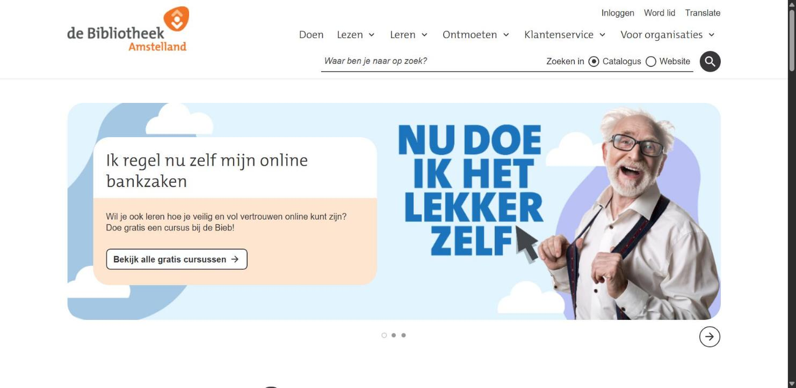
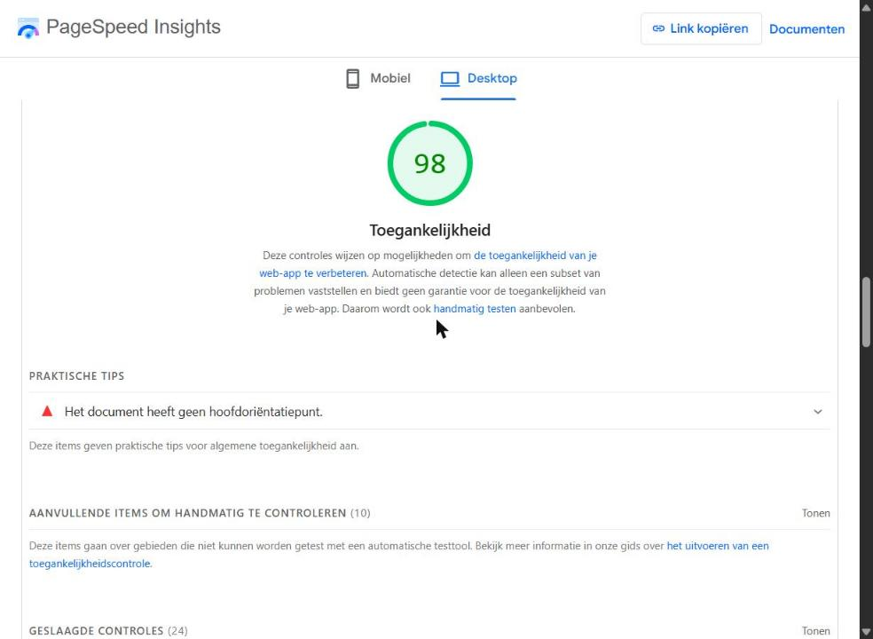

# WCAG Audit

Doe een WCAG audit op een bestaande website uit je eigen omgeving en rapporteer daarover.

De instructies van deze opdracht staan in [WIKI](https://github.com/fdnd-task/wcag-audit/wiki).

## Bibliotheek Amstelland

Ik heb de homepage van [Bibliotheek Amstelland](https://www.debibliotheekamstelland.nl/) getest, de openbare bibliotheek van Amstelveen, Aalsmeer en Uithoorn. Op de site kun je boeken zoeken in de catalogus, lid worden, inloggen en je aanmelden voor cursussen en activiteiten.

### Lighthouse Accessibility

### Samenvatting van de bevindingen

- **Lighthouse: 98/100.** Enige probleem: er is geen `<main>` landmark.
- **Keyboard:** goed bruikbaar. Skiplinks, zichtbare (maar dunne) focusrand, submenu's openen met `Enter` en sluiten met `Escape`. In het zoekformulier klopt de tab-volgorde niet met de visuele volgorde.
- **Screen reader:** alt-teksten en linkteksten zijn goed. Het hoofdmenu gebruikt onterecht `role="menubar"` en de carrousel kondigt nieuwe slides niet aan.
- **Interactive elements:** echte `<a>` en `<button>` elementen, `aria-expanded` op de submenu's. Het zoekveld heeft alleen een placeholder als zichtbaar label.
- **Headings & landmarks:** alleen `<nav>` is een landmark (geen `<header>`, `<main>`, `<footer>`), en alle secties zijn h3 waar h2 logischer is.

**Conclusie:** een hoge Lighthouse-score betekent niet automatisch dat een site goed toegankelijk is. De handmatige tests laten vooral verbeterpunten zien in de structuur van de pagina.

Volledige documentatie: [Wiki](https://github.com/SambalSamss/wcag-audit/wiki) — [Lighthouse test](https://github.com/SambalSamss/wcag-audit/wiki/Lighthouse-test) · [Handmatige tests](https://github.com/SambalSamss/wcag-audit/wiki/Handmatige-tests)

## Licentie

This project is licensed under the terms of the [MIT license](./LICENSE).
